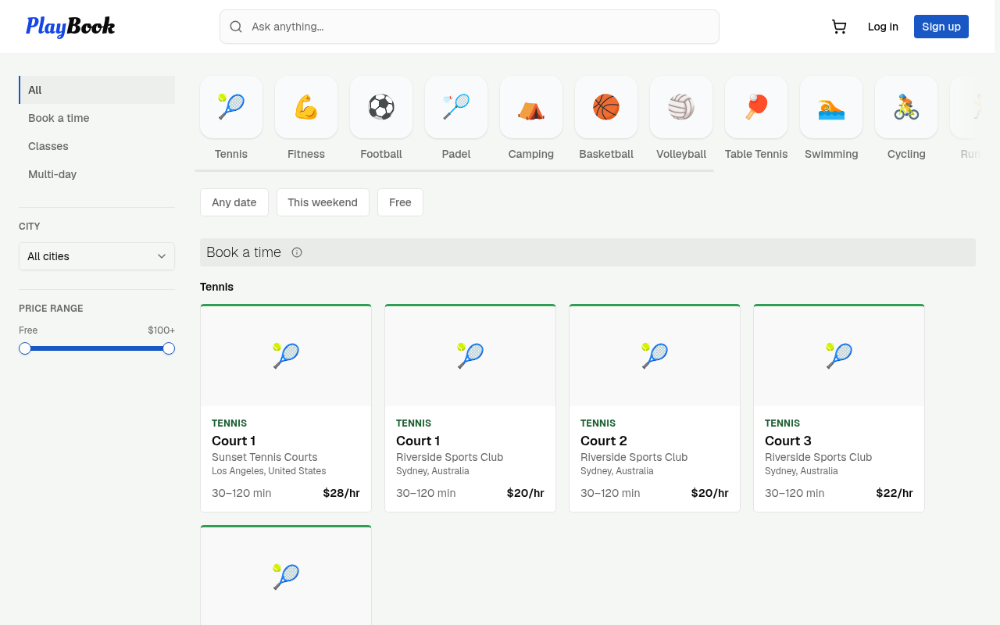
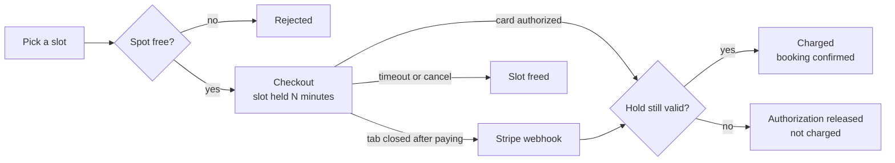
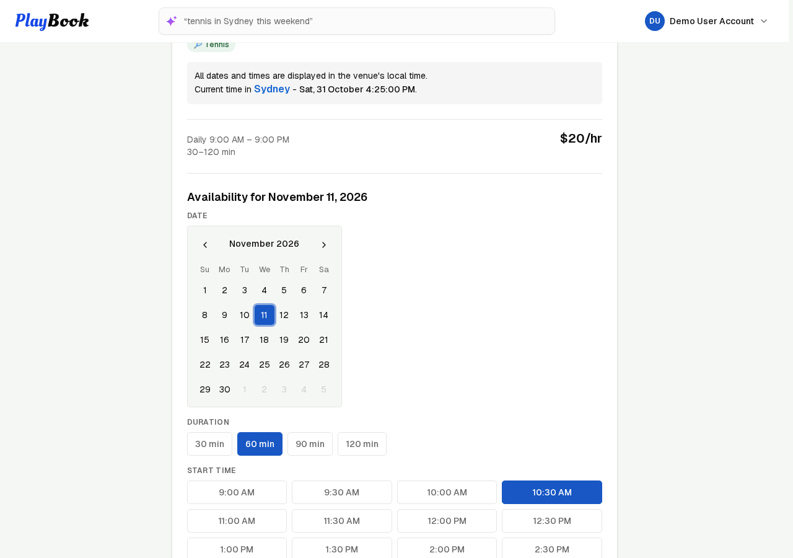
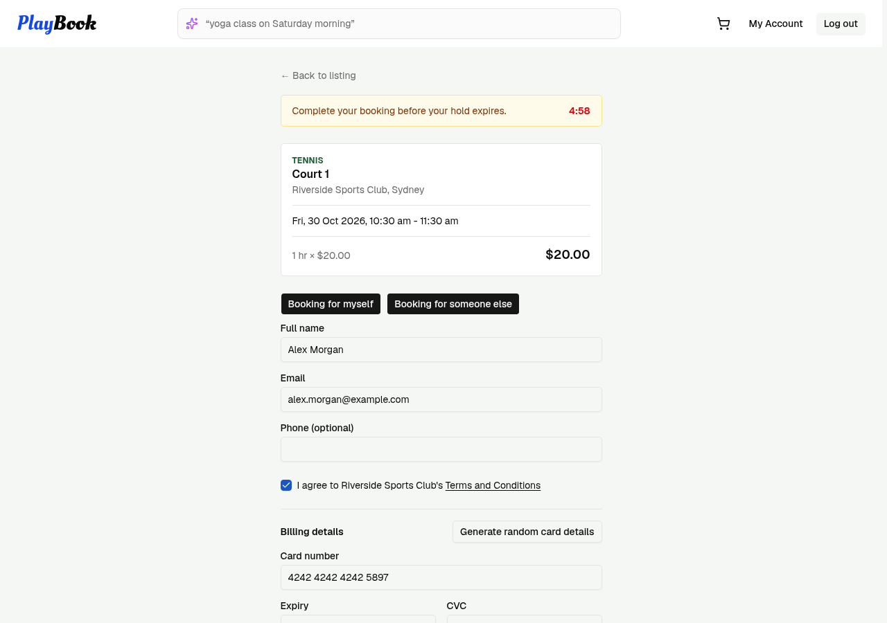
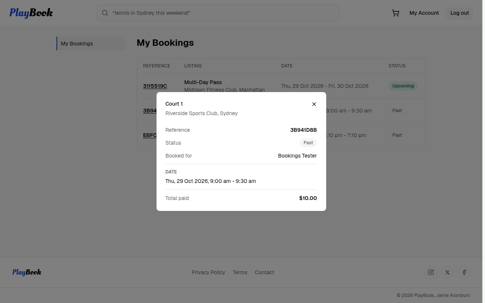
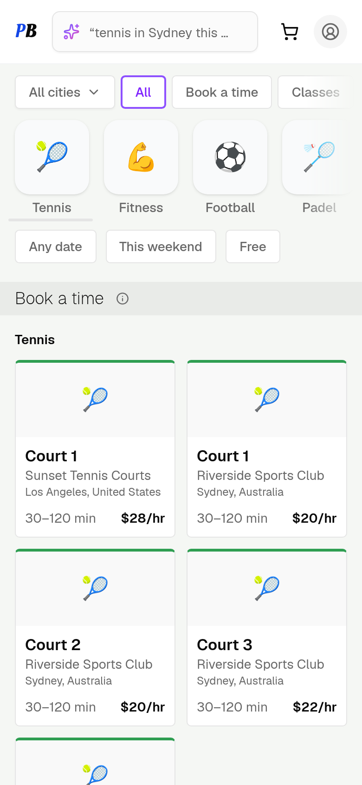
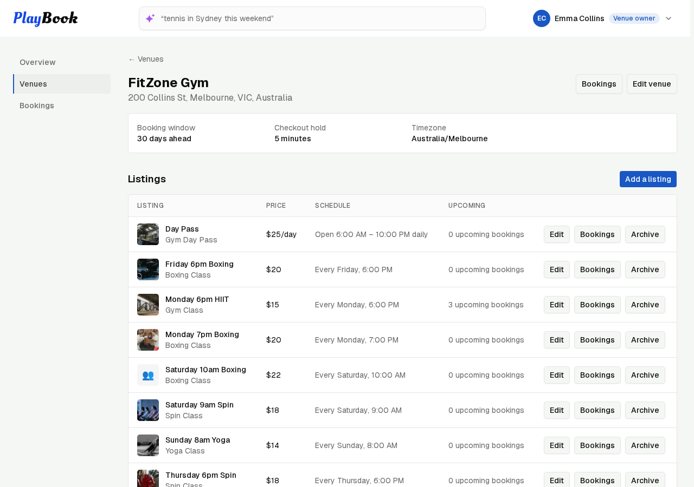
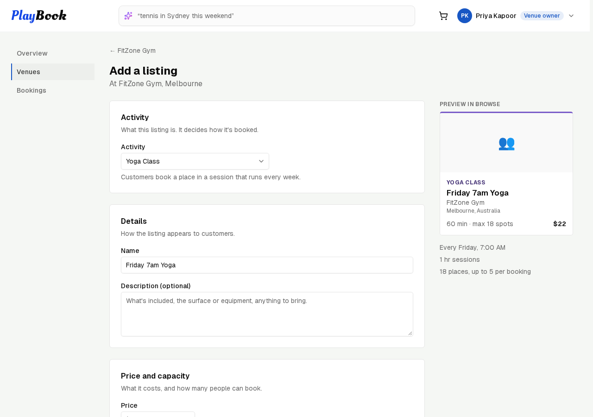

# PlayBook

[](https://github.com/jaimearamburo/sports-finder-app/actions/workflows/ci.yml)

A booking app for sports courts, fitness classes, day passes and campsites across several cities.

**Live:** [playbook-app-mauve.vercel.app](https://playbook-app-mauve.vercel.app). Use the demo buttons on the login page to sign in as a regular user or a venue owner. Payments are in Stripe test mode: card 4242 4242 4242 4242, any future date, any CVC.

**Stack:** Next.js 16 · React 19 · TypeScript · Tailwind CSS · Prisma · PostgreSQL · Auth.js · Stripe · Vercel Blob · Claude Haiku · Vercel



## Highlights

- **No double bookings.** Two people can't book the last spot at the same time. A test sends simultaneous requests and checks that exactly one succeeds.
- **No charge without a booking.** The card is only authorized at checkout. The money is taken after the booking is saved, so a late payment is released instead of refunded.
- **Natural language search.** "tenis in sydny ths weekend for free" becomes regular filters. The model can only choose from values that exist in the database, and search still works if the AI call fails. It uses a small, fast model (Claude Haiku), since the job is picking from a short list.
- **Venue dashboard.** Owners manage their venues, listings, photos and bookings. They only ever see their own: the server checks permissions and ownership on every request, not just the UI.

## How a booking works



Clicking Book Now holds the slot for N minutes (5 by default, set per venue). The capacity check locks the listing's row in the database, so a second request waits for the first to finish. A Stripe webhook finishes the booking if the customer closes the tab after paying.

## Design decisions

| Decision | Why |
| --- | --- |
| Pay on the site, not on Stripe's hosted page | A hosted Stripe session stays open at least 30 minutes, much longer than the checkout hold |
| Authorize first, charge later | Nobody pays for a slot they didn't get, and there are no refunds to manage |
| One booking in progress per user | Simpler and more reliable than detecting when someone leaves the checkout page |
| No table of time slots | Bookings have variable lengths, so availability is calculated from existing bookings |
| Grounded AI search: the query becomes filters, not embeddings | Listings are structured (sport, city, date, price), and queries like "this weekend" need exact dates, not similarity |

## Testing

| Type | Tool | What it covers |
| --- | --- | --- |
| Unit | Vitest | Booking rules, dates and time zones, prices, permissions, form validation |
| Database | Vitest + Postgres | Simultaneous bookings, browser and webhook finishing the same payment at once, expired holds, failed charges |
| End to end | Playwright | A full paid booking, who can access the dashboard, accessibility (axe) |
| AI Search | Eval script | 26 queries with typos, dates, prices and a prompt injection attempt. All pass; re-run after any prompt or model change |

CI runs type checks, lint, unit tests and the database tests on every pull request.

## Environments

- Development and production have separate databases and image storage.
- Database migrations run automatically on production deploys only.
- Work is planned as GitHub issues and merged from `dev` to `main` through pull requests.

## Not built yet

Booking cancellation and refunds · guest checkout · rate limiting and email verification · booking confirmation email · admin screen for cities, activities · weekly opening hours per venue, used as listing defaults

## About

A solo project. I owned the system design and the choice of framework and tool for each layer, and split the work into phases and GitHub issues before any code was written. The build itself was shared with AI: some tasks I wrote myself, others I delegated one at a time in a planned order, and every change was reviewed and tested before being committed.

Something I'm keen to explore next is using AI earlier, in the planning stage, to stress-test designs and surface edge cases before they become issues.

## Running locally

Needs Node 20.9+, pnpm and a PostgreSQL database of your own (for example a free Neon project).

```bash
pnpm install
cp .env.example .env              # fill in your own keys
pnpm exec prisma migrate deploy
pnpm exec prisma db seed
pnpm dev

pnpm test                         # unit tests
pnpm test:db                      # database tests
pnpm exec playwright install chromium
pnpm test:e2e                     # end-to-end tests
```

<details>
<summary>More screenshots</summary>

<table>
  <tr>
    <td></td>
    <td></td>
  </tr>
  <tr>
    <td></td>
    <td align="center"></td>
  </tr>
  <tr>
    <td></td>
    <td></td>
  </tr>
</table>

</details>
