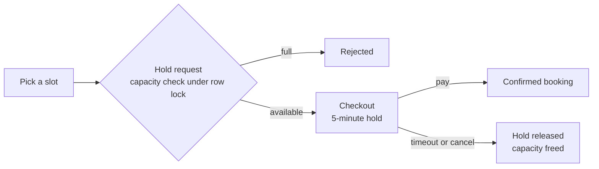

# PlayBook

Discover and book sports courts, fitness classes, day passes and campsites across multiple cities, with live availability and race-safe checkout.

**Live:** [playbook-app-mauve.vercel.app](https://playbook-app-mauve.vercel.app)


<table>
  <tr>
    <td></td>
    <td></td>
  </tr>
  <tr>
    <td></td>
    <td align="center"></td>
  </tr>
</table>

## What's implemented

- Reserve-then-confirm booking holds with expiring checkout timers
- Double-booking protection under concurrent requests (row-level locking)
- One active hold per user, platform-wide
- Three booking models: time slots, recurring classes, multi-day passes and stays
- Live availability that accounts for checkouts in progress
- Multi-city venues across time zones
- Time-zone-correct scheduling, validation and display
- Same-day booking cut-offs derived from opening hours
- Venue and listing availability overrides
- Shared client and server-side validation (Zod)
- Role-based access with structurally enforced auth guards
- Email/password and Google sign-in
- Security hardening: row-level security, server-enforced business rules, timing-safe login
- WCAG 2.2 AA accessibility, verified with axe-core
- Responsive, mobile-first UI with streaming loading states

## How a booking works



Requests flow through Server Components and Server Actions into an auth-guarded data layer, then Prisma and PostgreSQL. Capacity checks and the hold-to-booking conversion run inside transactions, so two people can never both secure the last spot.

## Tech stack

Next.js 16 (App Router) · React 19 · TypeScript · Tailwind CSS 4 · shadcn/ui (Base UI) · Prisma 7 · PostgreSQL (Supabase) · Auth.js v5 · Zod 4 · Vercel

## Running locally

Requires Node 20.9+, pnpm and a PostgreSQL database.

```bash
pnpm install
# .env: POSTGRES_PRISMA_URL, POSTGRES_URL_NON_POOLING, AUTH_SECRET, AUTH_GOOGLE_ID, AUTH_GOOGLE_SECRET
pnpm exec prisma migrate deploy
pnpm exec prisma db seed
pnpm dev
```

## Next up

Stripe test-mode payments · booking cancellation and refunds · rate limiting and email verification · guest checkout · dark theme · venue owner dashboard
