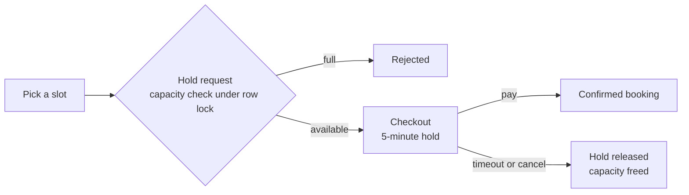

# PlayBook

Discover and book sports courts, fitness classes, day passes and campsites across multiple cities, with live availability and race-safe checkout.

**Live:** [playbook-app-mauve.vercel.app](https://playbook-app-mauve.vercel.app)


<table>
  <tr>
    <td></td>
    <td></td>
  </tr>
  <tr>
    <td></td>
    <td align="center"></td>
  </tr>
</table>

## What's implemented

- AI-powered natural-language search using an LLM, tolerant of typos and synonyms
- Reserve-then-confirm booking holds with expiring checkout timers
- Double-booking protection under concurrent requests (row-level locking)
- One active hold per user, platform-wide
- Three booking models: time slots, recurring classes, multi-day passes and stays
- Live availability that accounts for checkouts in progress
- Multi-city venues across time zones
- Time-zone-correct scheduling, validation and display
- Same-day booking cut-offs derived from opening hours
- Venue and listing availability overrides
- Shared client and server-side validation (Zod)
- Role-based access with structurally enforced auth guards
- Email/password and Google sign-in
- Security hardening: row-level security, server-enforced business rules, timing-safe login
- WCAG 2.2 AA accessibility, verified with axe-core
- Responsive, mobile-first UI with streaming loading states

## How a booking works



Requests flow through Server Components and Server Actions into an auth-guarded data layer, then Prisma and PostgreSQL. Capacity checks and the hold-to-booking conversion run inside transactions, so two people can never both secure the last spot.

## How search works

Search takes plain language, typos included: "tenis in sydny this weekend for free" or "racket sports somewhere warm". An LLM interprets the query into the app's existing filters (activities, city, dates, price) as schema-constrained JSON, limited to values that exist in the database. The result is validated again, shown as editable filter chips, and the regular filters run the search. If the AI call fails, search falls back to keyword matching.

**Why not embeddings?** The catalogue is structured: listings are defined by sport, city, schedule and price, not long descriptions. Searching it is about intent ("this weekend", "free", "racquet sports tomorrow"), which vector similarity can't express without several extra parsing layers, and typos break most date parsers. Query understanding handles intent, synonyms, typos, dates and price in one validated step. Embeddings are the better tool for ranking large, text-heavy catalogues, and could later be added as a ranking step within the filtered results.

**Why Haiku 5.5?** Mapping a short query onto a small, schema-enforced vocabulary is extraction, not deep reasoning. A small, fast model meets the real requirements: low latency and low cost per search. The evaluation set decides if a larger model is ever needed.

**Tested with evals.** A 26-query eval set runs the real model against expected filters: typos, synonyms, dates, prices, booking-type rules, nonsense and a prompt-injection attempt. Injection is contained by design: the output must pass a Zod schema whose tags and cities are enums of real database values, so even a manipulated response can only produce valid filters. Current result: 26/26.

## Tech stack

Next.js 16 (App Router) · React 19 · TypeScript · Tailwind CSS 4 · shadcn/ui (Base UI) · Prisma 7 · PostgreSQL (Supabase) · Auth.js v5 · Zod 4 · LLM (structured outputs) · Vercel

## Running locally

Requires Node 20.9+, pnpm and a PostgreSQL database.

```bash
pnpm install
# .env: POSTGRES_PRISMA_URL, POSTGRES_URL_NON_POOLING, AUTH_SECRET, AUTH_GOOGLE_ID, AUTH_GOOGLE_SECRET, LLM_API_KEY
pnpm exec prisma migrate deploy
pnpm exec prisma db seed
pnpm dev
```

## Next up

Stripe test-mode payments · embedding-based result ranking · booking cancellation and refunds · rate limiting and email verification · guest checkout · dark theme · venue owner dashboard
